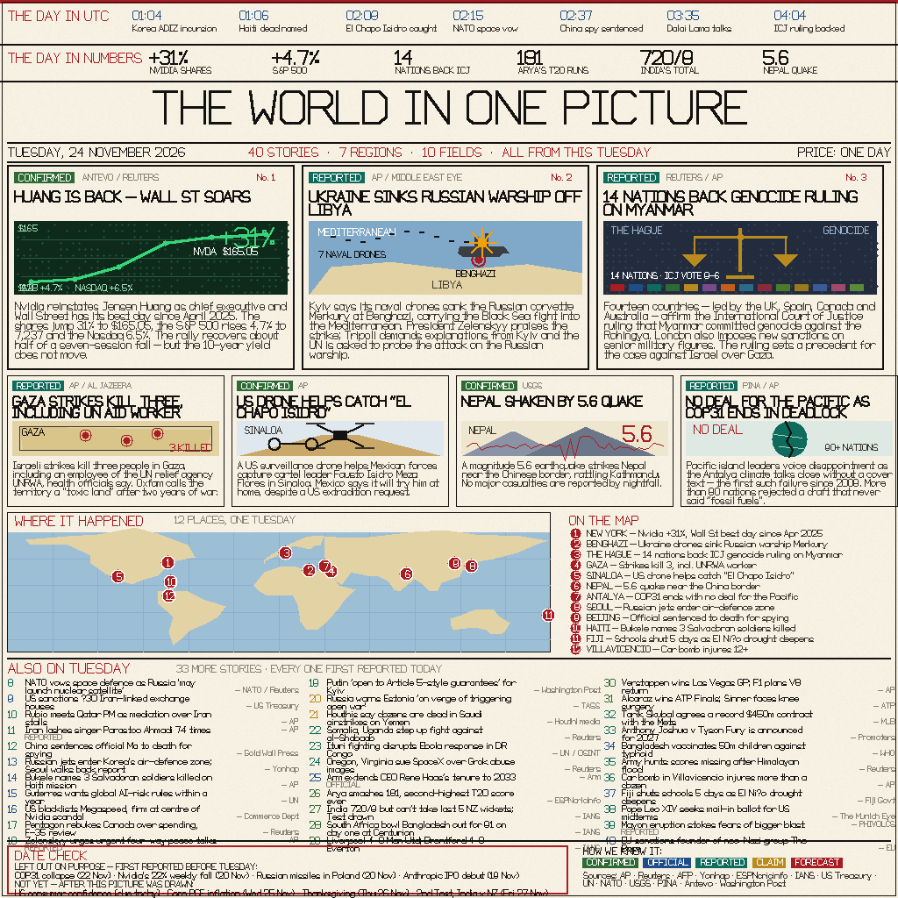

# The World in One Picture — 24 November 2026

[](https://make.fun/bounty/news-image-20261124)
[](https://make.fun/bounty/news-image-20261124)
[](https://make.fun/bounty/news-image-20261124)

A deterministic Node 22 program that draws a 1024×1024 newspaper infographic
summing up the world news of **Tuesday 24 November 2026** — and nothing else.
Entered in the [make.fun bounty](https://make.fun/bounty/news-image-20261124)
"Sum up 24 November's world news in one image".



## What the picture holds

**40 stories, all from this Tuesday** — every one an event that happened, or
was first reported, on 24 November 2026:

- **3 lead stories, each with its own drawn illustration:** Nvidia reinstates
  Jensen Huang and Wall Street has its best day since April 2025 (shares
  +31%); Ukraine's naval drones sink the Russian warship Merkury off Benghazi,
  Libya; fourteen nations back the ICJ genocide ruling on Myanmar.
- **4 more illustrated stories:** Israeli strikes kill three in Gaza,
  including a UNRWA worker; a US drone helps capture "El Chapo Isidro" in
  Sinaloa; a 5.6 earthquake shakes Nepal; COP31 ends in deadlock with no
  deal for the Pacific.
- **"THE DAY IN UTC"** — seven events with their UTC times — and
  **"THE DAY IN NUMBERS"** — six figures that define the day.
- **"WHERE IT HAPPENED"** — a world map with 12 numbered pins.
- **"ALSO ON TUESDAY"** — 33 more stories, numbered 8–40.
- **"DATE CHECK"** — what was deliberately left out (first reported before
  Tuesday) and what had not happened yet when the picture was drawn.
- **Verification on every story:** each carries a CONFIRMED / OFFICIAL /
  REPORTED / CLAIM / FORECAST label and its source (AP, Reuters, AFP,
  Yonhap, ESPNcricinfo, IANS, US Treasury, UN, NATO, USGS, and more).

## How it works

`main.ts` draws the whole page with a small canvas library written for this
entry (no dependencies, no network at run time):

- `src/png.ts` — a PNG encoder (zlib deflate, CRC32).
- `src/font.ts` — a single-stroke vector font drawn from scratch: a serif
  masthead face and a tight sans for the body text. No bitmap font, no
  external font files.
- `src/png.ts` and `src/font.ts` are the only modules; everything else —
  the charts, the maps, the scales of justice, the paper grain — is drawn
  in `main.ts` from the story data.

The program is deterministic: two runs write byte-identical PNGs.

```sh
mkdir -p out && MAKEFUN_OUTPUT_DIR=out node main.ts
# writes out/entry.png (1024x1024, ~408 KB)
```

## Sources

Every story was researched from live news reporting on 24 November 2026
(AP, Reuters, AFP, Yonhap, ESPNcricinfo, IANS, US Treasury, UN, NATO,
USGS, PINA, Antevo, Washington Post). The picture itself lists its sources
in the footer.

## License

MIT — see [LICENSE](LICENSE).
